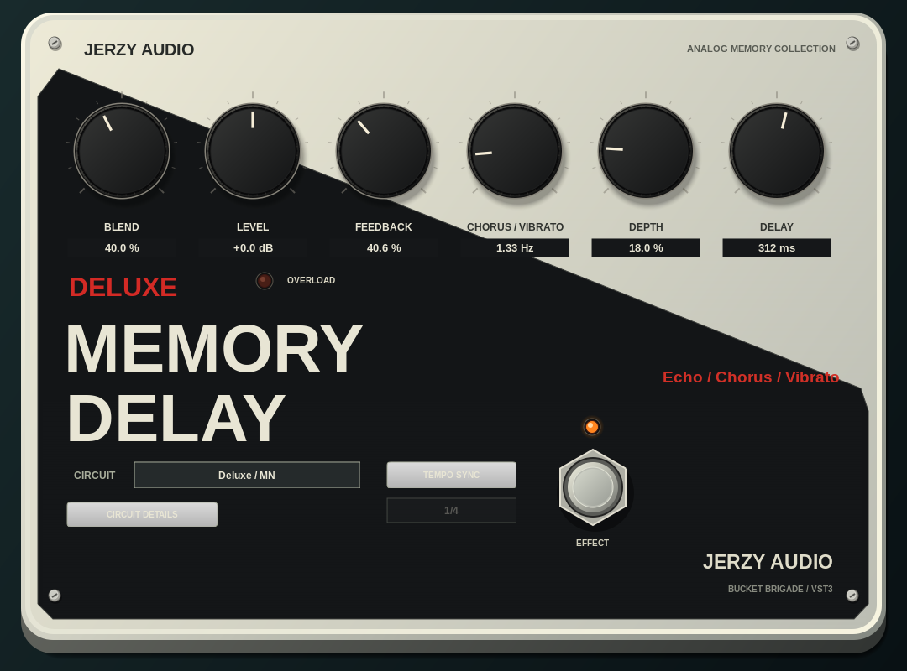

# Jerzy Memory Delay

Jedna kostka VST3 z sześcioma wariantami inspirowanymi analogowymi delayami EHX. Wektorowy panel o wyglądzie 3D nawiązuje do jasnej obudowy Deluxe Memory Man, z ukośną czarną grafiką, sześcioma gałkami, metalowym footswitchem i działającymi diodami.



Zweryfikowany stan wydania i ograniczenia platform: [VALIDATION.md](docs/VALIDATION.md).

## Modele

| Obwód | Zachowanie |
|---|---|
| EH7500 / SAD | 3072 komórki, bez kompandera, półkowy Boost |
| Issue A / SAD | Wczesny SAD1024, przybliżona bramka |
| Squelch / SAD | Wariant inspirowany EH7550, kompander i regulacja Squelch |
| Deluxe / MN | 8192 komórki, kompander, chorus/vibrato, do 550 ms |
| Boy / BL | Ciemniejszy profil współczesnego BBD i mocniejsza modulacja |
| Toy / BL | Ciemny, prosty profil z delikatniejszą modulacją |

To modele behawioralne, a nie pomierzona rekonstrukcja każdego tranzystora. Parametry Boy/Toy oraz maksymalne czasy wczesnych układów są przybliżeniami. Zakres i źródła opisuje [MODELLING.md](docs/MODELLING.md).

## Pobieranie VST3

Gotowe paczki są publikowane automatycznie po pomyślnej kompilacji i testach obu platform: [GitHub Releases](https://github.com/jurekbak71-dev/JerzyMemoryDelay/releases).

- [Windows x64 ZIP](https://github.com/jurekbak71-dev/JerzyMemoryDelay/releases/latest/download/JerzyMemoryDelay-Windows-x64.zip)
- [Linux x64 tar.gz](https://github.com/jurekbak71-dev/JerzyMemoryDelay/releases/latest/download/JerzyMemoryDelay-Linux-x64.tar.gz)

## Obsługa

- Blend: proporcja sygnału bezpośredniego i powtórek; Level: wejściowe wzmocnienie −12…+12 dB.
- Feedback: sprzężenie, również ponad próg samooscylacji. Przy dużych wartościach poziom powtórek może narastać.
- Chorus / Vibrato: prędkość LFO 0,15…8 Hz. Mały Blend daje chorus; Blend 100% i Depth > 0 daje modulowane echo/vibrato.
- Depth: głębokość modulacji zegara. Delay: żądany czas 20…550 ms, ograniczony zakresem modelu (Early 300 ms, Squelch 400 ms).
- Circuit: zmiana układu; stary ogon jest wygaszany, a obwód przełączany przez sygnał bezpośredni.
- Circuit Details: Boost, Squelch, kształt LFO i włącznik modulacji. Kontrolki nieobecne w danym obwodzie są nieaktywne.
- Tempo Sync: synchronizacja czasu echa z BPM hosta, również FL Studio. Włącz przycisk **TEMPO SYNC** i wybierz podział poniżej. Dostępne są `1/1`, `1/2`, `1/4`, `1/8`, `1/16`, `1/32`, `1/64`, każdy w wersji prostej, z kropką (`D`) i triolowej (`T`).
- Sync jest domyślnie wyłączony; stare sesje zachowują ustawienia i brzmienie. Po wyłączeniu Sync ponownie działa gałka Delay z poprzednią wartością. W Sync gałka jest nieaktywna, a jej wyświetlacz pokazuje wybrany podział. Tempo jest pobierane przez VST3 z hosta; jeżeli host chwilowo go nie przekaże, pozostaje ostatnia poprawna wartość (przy starcie 120 BPM). Obsługiwany zakres wynosi 10–1000 BPM.
- Długie podziały w Sync rozszerzają zakres zegara BBD zamiast skracać nutę do limitu sprzętowego. Przy wolnym zegarze echo staje się ciemniejsze; czasy ręczne i dotychczasowe profile pozostają bez zmian.
- Footswitch: bypass; pomarańczowa dioda wskazuje aktywny efekt, czerwona przeciążenie wejścia.
- Prawy przycisk na gałce przywraca ustawienie domyślne. Shift umożliwia precyzyjniejszy ruch. Menu kontekstowe edytora zawiera skalę GUI.

Dwa kanały są przetwarzane osobno ze wspólnym zegarem modulacji, bez sztucznego crossfeed. To rozszerzenie mono oryginałów. Częstotliwości próbkowania 8–384 kHz, float i double, zapis parametrów i automatyka z offsetami próbek. Bypass ma krótkie wygładzenie, odcina nowe wejście do echa i ukrywa jego ogon; bufor wewnętrzny nadal pracuje.

## Budowanie Windows x64

Wymagane CMake ≥3.25, Git i Visual Studio 2022 z Desktop development with C++. SDK pobierane jest automatycznie z przypiętej rewizji, razem z submodułami.

```powershell
cmake -S . -B build -G "Visual Studio 17 2022" -A x64
cmake --build build --config Release --parallel 2
ctest --test-dir build -C Release --output-on-failure
```

Cały katalog `build/VST3/Release/JerzyMemoryDelay.vst3` należy skopiować do `C:\Program Files\Common Files\VST3`. Zawiera zarówno moduł, jak i zasoby GUI. Workflow GitHub Actions automatycznie buduje, uruchamia walidator Steinberga, testy DSP/hosta i pakuje ZIP po pushu na `main`.

## Budowanie Linux

Zależności i uruchomienie testów wirtualnego ekranu podano w `.github/workflows/build.yml`.

```sh
cmake -S . -B build -G Ninja -DCMAKE_BUILD_TYPE=Release
cmake --build build --parallel 2
xvfb-run -a ctest --test-dir build --output-on-failure
```

Gotowy bundle należy umieścić w `~/.vst3/`. Własny rekurencyjny checkout SDK można wskazać przez `-DVST3_SDK_ROOT=/path/to/vst3sdk`. Same testy DSP nie potrzebują SDK ani bibliotek graficznych:

```sh
cmake -S . -B build-dsp -DJERZY_BUILD_PLUGIN=OFF
cmake --build build-dsp
ctest --test-dir build-dsp --output-on-failure
```

`python3 scripts/generate_ui.py` regeneruje układ edytora. Rysowanie obudowy i kontrolek znajduje się w `source/editor.cpp`; nie wymaga obrazów producenta.

## Środowisko chmurowe

Na przygotowanym obrazie Debian: `bash scripts/setup_cloud.sh`, następnie `bash scripts/build_cloud.sh`. Instalator działa lokalnie pod `/workspace/shared`, bez uprawnień administratora. Wykorzystuj istniejący checkout projektu; zadania chmurowe są już izolowane i nie wymagają worktree.
